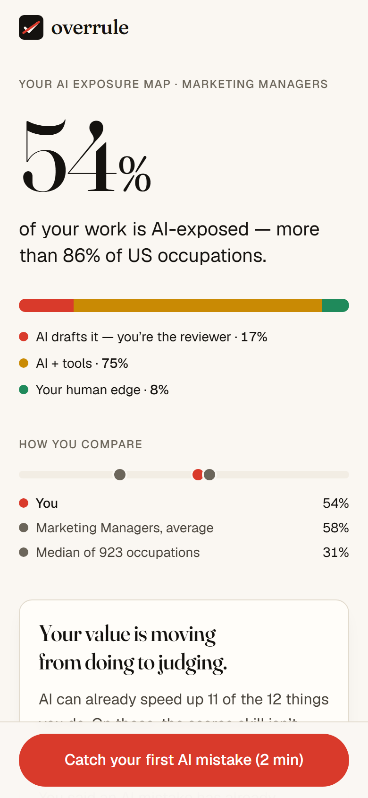
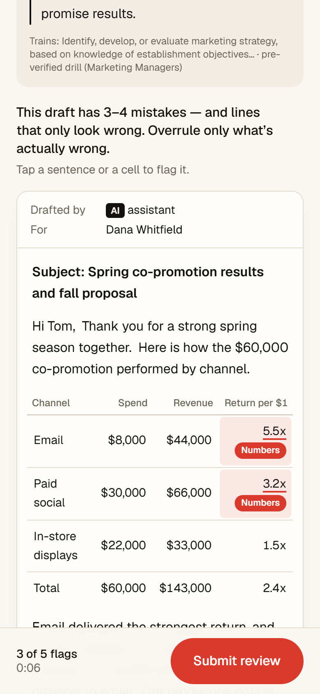
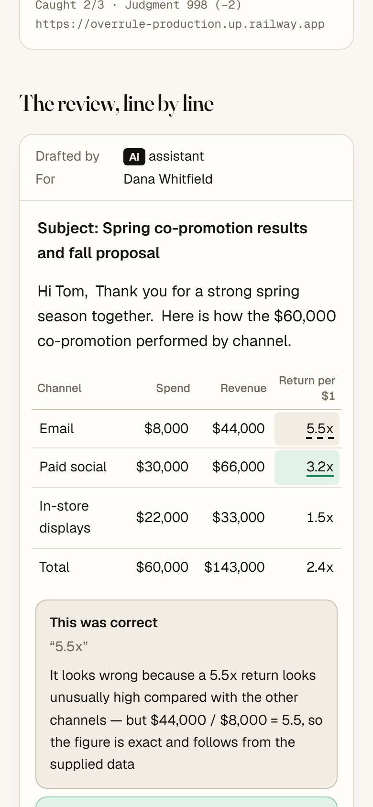
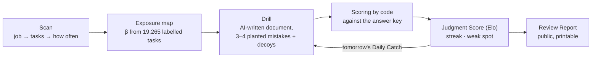
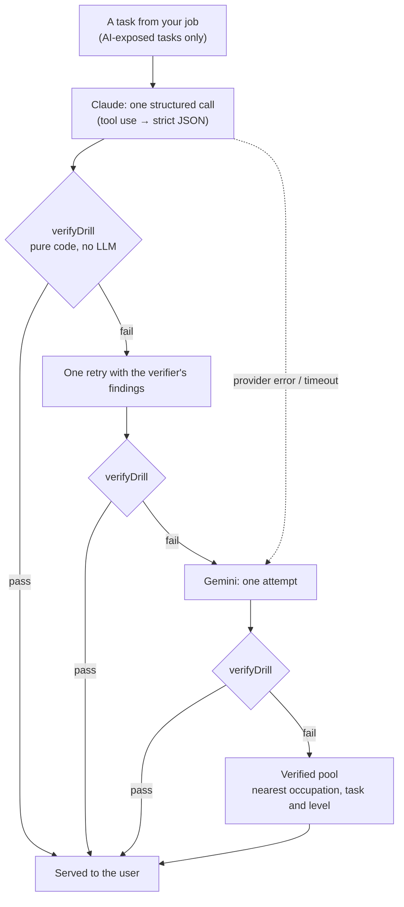

# Overrule

**AI does the work. You get paid for the judgment.**

Overrule is a 5-minute daily drill and a rating for the skill people are now paid for: reviewing AI's work and
answering for the result. Every day you get a document from your own profession, "written by AI", with 3–4 planted
mistakes and one or two lines that only _look_ wrong. You flag what is actually wrong, get a line-by-line review,
and your Judgment Score moves.

[](https://github.com/gennadiy0041/overrule/actions/workflows/ci.yml)

- **Live:** https://overrule-production.up.railway.app — no sign-up, no login
- **Pitch deck:** [deck/Overrule_BusinessCup2.pdf](deck/Overrule_BusinessCup2.pdf) (the stage version, which plays
  the film, is [deck/pitch.html](deck/pitch.html); `bun run build-pptx` makes the same deck as a PowerPoint file
  with the film embedded)
- **30-second film:** https://overrule-production.up.railway.app/film
- **60-second walkthrough:** [docs/demo.mp4](docs/demo.mp4)

Built solo in 24 hours for Business Cup 2.0 (Zimran × AIESEC), Skills track.

---

## Judges' quick path (3 minutes)

1. Open the [live product](https://overrule-production.up.railway.app) on a phone or a laptop. Tap **Scan my job — free**.
2. Type a job title (try your own — all 923 O\*NET occupations work; leadership roles from CEO to HR director are
   offered on the same screen, and titles such as "VP of sales" or "chief people officer" are classified when typed),
   keep or change the pre-selected tasks,
   answer four one-tap questions. You get a **personal AI-exposure map** computed from real labour data.
3. Tap **Catch your first AI mistake**. A drill is generated for a task from your job while you read the map
   (if the model is unavailable you get a drill from the verified pool instead, and the page says so).
   Tap the sentences or table cells you think are wrong, pick the mistake type, submit.
4. Read the annotated review, watch the **Judgment Score** move, then continue through the soft paywall
   (**Continue with free plan** always works; the demo checkout collects no payment) to the dashboard.
5. Short on time? Open the [**demo profile**](https://overrule-production.up.railway.app/demo): a simulated week for
   "Jess, marketing manager", produced by a scripted player running through the real engine. You can play today's
   Daily Catch as Jess.
6. Try [**Defend your work**](https://overrule-production.up.railway.app/defend): tap **Use a sample report**, then
   **Find the hard questions**. You get five questions, each about a line of that text; answer one or two and
   score them. The first rehearsal is free; the pack after it is a demo checkout.

Also worth a look: one of the 923 SEO pages, e.g.
[/will-ai-replace/marketing-managers](https://overrule-production.up.railway.app/will-ai-replace/marketing-managers),
and the method page [/about](https://overrule-production.up.railway.app/about).

<p>
  
  
  
</p>

Screenshots and the walkthrough video are captured from production by `bun run screenshots` and
`bun run record-demo`; the deck is built from them by `bun run build-deck`.

`bun run build-pptx` (Windows with PowerPoint, plus ffmpeg) turns the stage deck into
`deck/Overrule_BusinessCup2.pptx`: every slide is a picture of the HTML deck, so it looks the same on a computer
without the deck's fonts; the film is stored inside the file and starts when its slide opens; the speaker notes
carry the pitch script. PowerPoint itself assembles the file and then checks it (`scripts/check-pptx.ps1`): it
records the whole slide show, and the recording must contain the film, in sync and with its sound. The `.pptx`
files are not committed (40 MB with the full-quality film; `--light` gives a 13 MB copy).

---

## The problem

AI is now mandatory at work, and its mistakes are still yours.

| Fact                                                                                   | Source                                                                                                    |
| -------------------------------------------------------------------------------------- | --------------------------------------------------------------------------------------------------------- |
| 58% of US workers rely on AI output without properly checking it; 57% have made mistakes at work because of AI | [KPMG US, Trust in AI, Apr 2025](https://kpmg.com/us/en/media/news/trust-in-ai-2025.html) (n = 1,019)     |
| 30% of US employees use AI at work a few times a week or more (11% in 2023)            | [Gallup AI indicator, May 2026](https://www.gallup.com/699797/indicator-artificial-intelligence.aspx)     |
| 40% of US workers received "workslop" in the past month; 42% trusted the sender less   | [Stanford Social Media Lab × BetterUp, via The Register](https://www.theregister.com/2025/09/26/ai_workslop_productivity/) |
| Accepting AI output without checking it is treated as a performance problem            | [VKTR, Mar 2026](https://www.vktr.com/employee-experience/how-managers-weigh-employee-ai-use-in-performance-reviews/) |

Courses teach people to _do more_ with AI. The few tools that train spotting AI's mistakes are built for lawyers or
as games; nobody trains it on your own job's tasks, or measures it.

**Who it is for:** US office professionals aged 25–45 who use AI at work every week and are still the ones who sign
the result. **What they pay for:** personal drills built from their own tasks, weak-spot training, a weekly debrief
and a report for their self-review ($99.99/year with a 7-day trial, or $19.99/month). **Why they come back
tomorrow:** one shared Daily Catch per profession per day, a streak, and a score that only moves when they play.

---

## How it works



### Discover — the exposure map is real data, not a quiz result

- Source: the task-level labels of [Eloundou et al., "GPTs are GPTs"](https://arxiv.org/abs/2303.10130)
  ([dataset, MIT](https://github.com/openai/GPTs-are-GPTs)) over O\*NET task statements: **19,265 tasks, 923 occupations**.
- `β = Σ wᵢ·vᵢ / Σ wᵢ` with `v(E1) = 1`, `v(E2) = 0.5`, `v(E0) = 0`. For an occupation `w(Core) = 2`, otherwise 1.
  For a person, `w` is how often they do the task (`often = 3`, `sometimes = 2`, `rarely = 1`).
- **The engine reproduces the published human-rated β for all 923 occupations with |Δ| < 1e-9** — that is the first
  unit test in the repository ([tests/unit/exposure.test.ts](tests/unit/exposure.test.ts)).
- One honest footnote: the published CSV stores one occupation as `0.39999999999999997` instead of `0.4`, which
  shifts a neighbouring percentile by 0.1. We rank on β recomputed from the task labels; a test documents it.
- Job-title search covers the 923 official titles, ~48,500 O\*NET alternate titles and a small dictionary of modern
  titles ("growth marketer" → Marketing Managers).

### Develop — a drill is generated, then proven by code



`verifyDrill` ([src/engine/verifyDrill.ts](src/engine/verifyDrill.ts)) is deterministic and unit-tested. A drill is
served only if:

- it matches the zod schema shared by the server and the client ([src/engine/drillSchema.ts](src/engine/drillSchema.ts));
- every referenced sentence or cell exists, decoys never overlap mistakes, and there are at least three mistake types;
- it respects the level's limits (number of mistakes, number of decoys, length);
- **every number checks out**: each numeric claim carries an arithmetic expression that our own evaluator
  ([src/engine/safeMath.ts](src/engine/safeMath.ts) — numbers, `+ − × ÷` and parentheses; no `eval`) recomputes.
  A planted numbers mistake must really be wrong; every other figure must really be right.

For the pre-built pool there is one more gate: **a different model solves the drill blind** (Gemini, or a second
Claude model when Gemini is unavailable), seeing only what a user sees, and the drill is kept only if it finds at
least half of the planted mistakes. Counts of generated, accepted
and rejected drills are in [data/pool/stats.json](data/pool/stats.json).

The launch pool holds **54 drills for six occupations**: of 87 model drafts, 39 were rejected by the verifier and 48
were accepted and cross-checked. The remaining six (Customer Service) were written in the build session after the
model account ran out of credit; they are verified by the same code and, once credit was back, passed the same
blind cross-check (the solver found 19 of their 20 planted mistakes). All 54 drills are cross-checked.

The user never sees a provider error: the wait screen streams the real stages over SSE, and after 45 seconds the
verified pool takes over. The first drill starts generating in the background as soon as the tasks are picked in
the scan, and the shared Daily Catch of an occupation without a pool as soon as the scan is finished. In scripted
visits to production on 2026-11-15 (a browser that pauses briefly to "read") a draft took about 26 s, the first
drill appeared 11–12 s after pressing start, and the Daily Catch opened in 2 s. When a live generation fails, the
pool is served at once for the next three minutes instead of making the
next person wait for the same outage — and live drills come back by themselves when the provider does.

**The answer key never leaves the server before submission** (`toPublicDrill`), which the API test asserts.

### Prove — scoring and the Judgment Score

Hits are decided **by code against the key**, never by a model's opinion:

```text
maxPoints = Σ_key (10·severity + 5 + 6)
points    = Σ_hits (10·severity + 5·[right type] + 3·why) − 5·false flags − 8·flagged decoys
p         = clamp(points / maxPoints, 0, 1)
```

Over-flagging costs points: the skill is calibration, not suspicion. A model is asked for one thing only — grading
the optional one-line "why" notes (0–2) — with a 12-second budget and a keyword-overlap heuristic as fallback.

The Judgment Score is Elo against the drill's level:

```text
D(level) = {1: 800, 2: 950, 3: 1100, 4: 1250, 5: 1400}; start R = 1000
E  = 1 / (1 + 10^((D − R) / 400));   K = 40 for the first 10 drills, then 24
R' = round(R + K·(p − E))
```

The next level is the one whose difficulty is closest to `R − 70`; the mistake type with the worst catch rate over
the last ten drills is forced into the next personal drill. Percentiles are shown only against real players (no
demo profiles, no internal traffic) and stay locked until there are 20 of them.

### Defend — rehearse the questions before you send

The drills are practice. **Defend your work** (`/defend`) is for the real deadline: the fear that a manager asks
"where does this number come from?" about a report AI drafted. A person pastes the text they are about to send
(200–8,000 characters) and says who will read it; they get five questions, each about one line of their own text,
answer them, and see which answers hold.

The same rule as in the drills applies: **the model writes, code decides what is kept.**

- **Questions.** Claude writes five questions, each with the line it is about. `groundQuestions`
  (`src/engine/rehearsal.ts`) keeps a question only if its quote really is in the document (spacing, case and
  typographic quotes aside) and no line is questioned twice. Fewer than three grounded questions and the whole set
  is rejected and recorded as a failed call.
- **Answers.** One scored round per rehearsal: `holds`, `partial` or `open`, with one sentence on what to add.
  The model is asked whether an answer is specific and checkable. It cannot verify that it is true, the prompt
  forbids it to say so, and the page says the same. A blank answer is `open` without a model call.
- **Without a model** — our own traffic, a spent budget, a provider failure, a rejected set — a rule-based reader
  takes over: it finds the lines with a figure, an unnamed source, a stated cause, an absolute promise or a
  recommendation and asks what follows from each; answers are scored by whether there is one and whether it gives
  the reader something to check. The page says which of the two wrote the questions.
- **Nothing a person pastes is stored**: not the document, not the questions, not the answers. The database keeps
  counts only (`rehearsals`, `rehearsal_packs`); the questions travel back to the server with the answers.
- **Price.** The first rehearsal is free, then a pack of 5 for $4.99, sold apart from the subscription because it
  answers a one-off need, not a habit. The pack uses the same demo checkout as the subscription.

It shipped on the morning of the deadline, after outside feedback that the product lacked a reason to open it
before a real task. What backs it: 28 unit and API tests, an end-to-end run on phone and desktop, and one live run
in production with the model (questions in 7 seconds, verdicts in 4). It has had no outside users.

---

## Architecture

| Layer    | Choice                                                                                                 |
| -------- | ------------------------------------------------------------------------------------------------------ |
| Runtime  | Bun, TypeScript strict (`noUncheckedIndexedAccess`), zod everywhere                                    |
| Server   | Hono: JSON API, SSE for generation progress, server-rendered pages (SEO, public reports, `/metrics`)   |
| Web      | React + Vite + Tailwind v4, served by the same process; the drill and everything after the landing are code-split |
| Storage  | SQLite (`bun:sqlite`) on a Railway volume, forward-only migrations applied at boot                     |
| Models   | Claude (primary) → Gemini (secondary) → verified pool; plain `fetch`, no SDKs                          |
| Hosting  | Railway, Dockerfile on `oven/bun`, health check `/api/health`, SQLite on a volume                      |

```text
src/engine/     pure TypeScript, no I/O — exposure, drillSchema, verifyDrill, safeMath, scoring, elo,
                adaptive, daily, share, search. Everything here is unit-tested.
src/shared/     the HTTP contract (zod request schemas + response types) used by server and web
src/server/     routes/ · services/ (drill service, demo seeding, metrics, report) · repos/ · llm/ · ssr/
src/web/        React app: pages/, drill/, ui/ (small kit), lib/
data/           occupations.json (built by scripts/import-data.ts), pool/ (verified drills), raw sources
scripts/        import-data, generate-pool, llm-smoke, screenshots, build-deck, build-pptx, record-demo, build-og
tests/          unit/ (engine + an API test that walks the whole product path), e2e/ (Playwright, against prod)
deck/           the pitch deck (PDF, the HTML it is built from, production screenshots)
docs/           decisions.md, the walkthrough video, pitch script and Q&A (Russian), LinkedIn post
```

Design decisions worth knowing are logged in [docs/decisions.md](docs/decisions.md).

### Sessions and privacy

Anonymous cookie sessions: no accounts, no email, no personal data. Survey answers and "why" notes are free text
limited to 80–140 characters. Text pasted into Defend your work is used for one model call and never written to
the database. API keys live only in server environment variables.

### Cost guards

Every model call is recorded in `llm_calls` (purpose, provider, model, latency, outcome, tokens). Three guards sit
on top of that ledger:

- **A dollar ceiling** (`LLM_BUDGET_USD`, default 20). Spend is estimated from the ledger — token counts at list
  prices, timed-out calls counted at their ceiling, so it errs high. A generation starts only while its worst case
  and that of every generation in flight still fit. At the ceiling the product stops calling models by itself:
  drills come from the verified pool and notes are graded by the heuristic. `/metrics` shows spend against the ceiling.
- **Daily caps by count** on live generations, per session and across all sessions (`GEN_LIMIT_PER_SESSION`,
  `GEN_LIMIT_GLOBAL`).
- **Internal traffic never calls a model**: automated browsers and `/?internal=1` sessions get pool drills and
  heuristic grading.

Rehearsals sit under the same ceiling, with their own caps: at most 10 model-written rehearsals per session a day
and 40 an hour across the product; past either, the rule-based reader writes the questions.

Measured on 2026-11-15: one level-2 drill accepted on the first draft took 4,270 input and 5,070 output tokens on
Claude Sonnet 5.5, about $0.06 at list prices; grading the notes of one attempt on Claude Haiku 5.5 costs a
fraction of a cent. One rehearsal of a 590-character report took 1,323 input and 659 output tokens on Sonnet 5.5
for the questions and 1,200 + 262 on Haiku 5.5 for the verdicts: about $0.01.

---

## Run it locally

```bash
bun install
bun run import-data        # builds data/occupations.json from data/raw (already committed)
bun run build              # web app → dist/web
bun start                  # http://localhost:3000
```

Without API keys the product still works end to end from the verified pool. For live generation copy
[.env.example](.env.example) to `.env` and set `ANTHROPIC_API_KEY` and/or `GEMINI_API_KEY`.

Development: `bun run dev` (server with reload) and `bun run dev:web` (Vite on :5173, proxying the API).

| Variable                | Purpose                                                                |
| ----------------------- | ---------------------------------------------------------------------- |
| `PORT`, `DB_PATH`       | Port and SQLite file (on Railway: `/data/overrule.db` on the volume)   |
| `APP_URL`               | Public origin for share links, sitemap and Open Graph                  |
| `ANTHROPIC_API_KEY`, `CLAUDE_MODEL`, `CLAUDE_FAST_MODEL` | Primary provider; the fast model grades the "why" notes |
| `GEMINI_API_KEY`, `GEMINI_MODEL` | Secondary provider                                            |
| `METRICS_TOKEN`         | Protects `/metrics?token=…`                                            |
| `GEN_LIMIT_PER_SESSION`, `GEN_LIMIT_GLOBAL` | Daily caps on live generations                     |
| `LLM_BUDGET_USD`        | Ceiling on total model spend in US dollars (estimated); default 20     |

## Tests

```bash
bun run typecheck   # tsc --noEmit
bun run test        # 445 unit tests, including two API tests (in-memory SQLite, fake model provider)
bun run e2e         # Playwright against production: phone and desktop
```

What the tests pin down:

- `exposure` reproduces `human_rating_beta` for all 923 occupations and the percentile table;
- `safeMath` accepts only numbers, operators and parentheses; rejects identifiers, exponent notation, division by zero;
- `verifyDrill` passes the reference drill and fails each mutation (missing target, decoy inside the key, fewer than
  three types, a "numbers mistake" that is actually correct, …);
- `scoring` and `elo` match the worked examples (56 of 144 points; +1 at level 3 from 1000);
- `daily` handles ET day boundaries, both DST switches and streaks;
- the API test walks scan → map → drill → submit → dashboard → checkout → practice → report → metrics and asserts
  that the answer key is absent from the drill payload;
- `rehearsal` and the Defend API test: a question that quotes a line the author never wrote is dropped, a set with
  too few grounded questions is rejected, nothing of the pasted text reaches the database, a rehearsal is scored
  once, the second one needs a pack, and internal traffic or a spent budget never calls a model.

## Metrics

Funnel events are stored in SQLite and shown on `/metrics?token=…`: unique-session funnel with step conversion,
D1 returns, Daily Catch completions and shares, survey answers (with N), and model-call statistics. Internal
traffic (team browsers via `/?internal=1`, automated tests, the demo profile) is excluded.

---

## Honest limitations

- **Exposure labels are from 2023** and measure potential speed-up of a task, not job loss. O\*NET describes a
  typical job; that is why the scan asks which tasks you actually do.
- **Drills are AI-generated.** Verification proves structure and arithmetic; it cannot prove that a "logic" or
  "audience" mistake is unambiguous. The blind cross-check covers the pool, not live drills.
- **The Judgment Score is a practice record**, not a credential. Employer recognition is a later stage.
- **Live generation needs model credit and stops at the dollar ceiling.** Without credit, or past the ceiling, the
  product runs entirely from the verified pool; for occupations outside the launch six that means a drill from the
  closest pooled occupation, labelled as such.
- **Checkout is a demo**: no payment is collected in this build, for the subscription or for the rehearsal pack.
  Unit economics in the deck are hypotheses to be tested with a small ad budget.
- **Defend your work judges form, not truth.** It tells you whether an answer is specific and checkable; it cannot
  know whether your number is right. It shipped on the morning of the deadline and has had one live run with the
  model.
- **One process, one replica**: in-flight generations are tracked in memory; SQLite on a single volume.
- The pool rotates through a fixed set per profession; a production Daily Catch needs a fresh, reviewed drill per day.

## Roadmap

1. Paid acquisition test ($300–500) on the scan funnel to replace CAC and conversion hypotheses with data.
2. Real checkout (Stripe on the web — no store commission), cancellation and refunds.
3. "Second Look": paste your own AI draft, review it yourself first, then compare with Overrule's findings.
4. A reviewed daily drill per profession; levels that track model progress as mistakes get subtler.

## Licences and attribution

- Code: [MIT](LICENSE).
- Exposure labels: Eloundou, Manning, Mishkin, Rock, "GPTs are GPTs" — dataset under the MIT License.
- Task statements and alternate titles: O\*NET® Database, U.S. Department of Labor, Employment and Training
  Administration (USDOL/ETA), used under CC BY 4.0; Overrule has modified this information. Exact wording and
  versions are in [data/ATTRIBUTION.md](data/ATTRIBUTION.md).
- Companies and people in drills are fictional.
